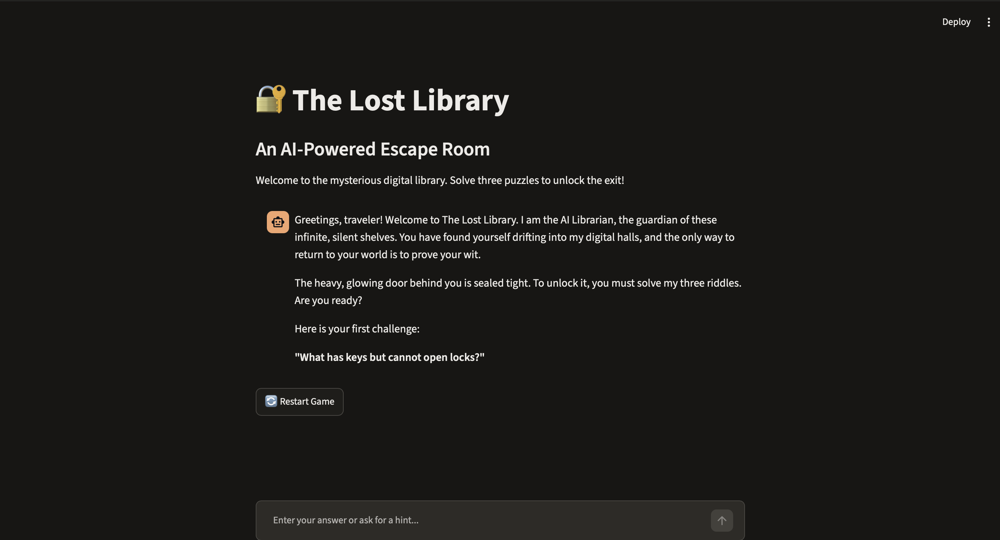
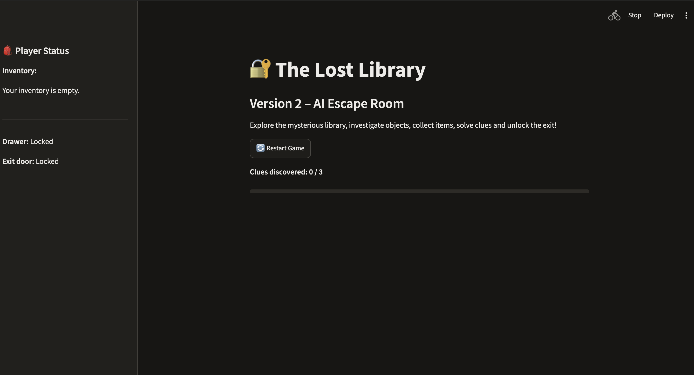
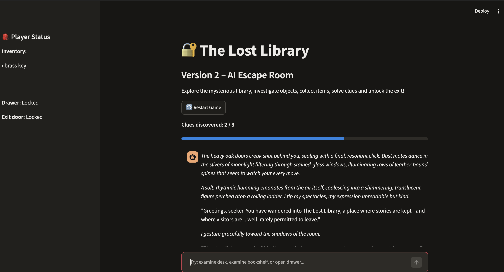
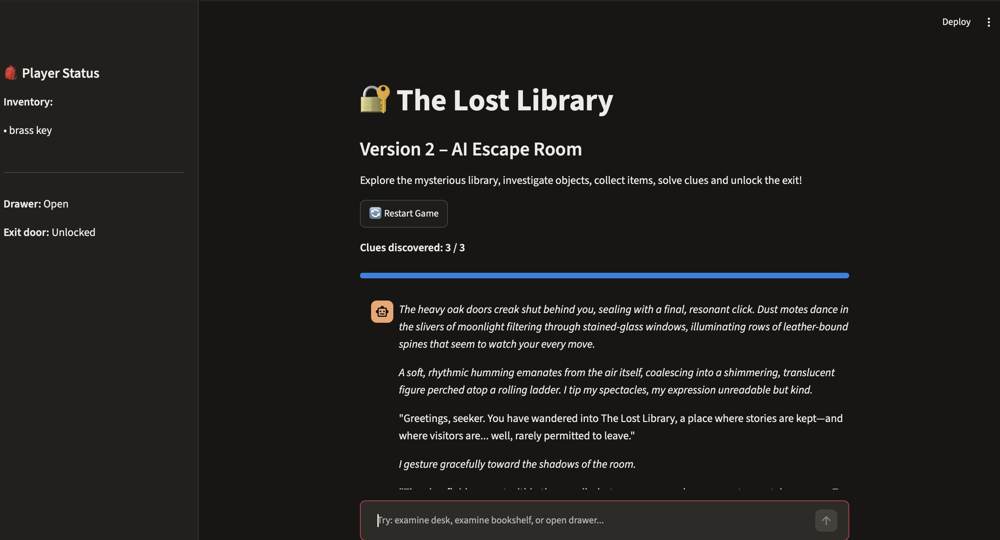

ø¯git status# 🔐 AI-Powered Escape Room

An interactive AI-powered escape room developed using **Python, Streamlit and Google's Gemini API**.

This project explores how AI can create an engaging gaming experience while Python ensures reliable game rules, structured state management and action validation.

## 🎮 Project Overview

The project contains two versions:

### Version 1 – Basic AI Escape Room
- Interactive Streamlit web application.
- Gemini acts as the AI Game Master.
- Three riddles with natural language interaction.
- AI-generated storytelling, clues and responses.
- Basic puzzle progression.

### Version 2 – Structured AI Escape Room
- Python-based game engine.
- Structured inventory and game-state management.
- Action validation before changing game progress.
- Key-based drawer access.
- Four-digit exit code validation.
- Gemini handles storytelling while Python controls game decisions.

## 🖥️ Application Screenshots

### Version 1 – AI Escape Room



### Version 2 – Game Interface



### Inventory Management



### Successful Escape



## 🛠️ Technologies Used

- Python
- Streamlit
- Google Gemini API
- Google GenAI SDK
- python-dotenv
- Git and GitHub

## 🏗️ Project Structure

```text
ai-powered-escape-room/
│
├── version1/
│   ├── app.py
│   └── game_master.py
│
├── version2/
│   ├── app.py
│   ├── game_engine.py
│   ├── game_master.py
│   └── game_config.json
│
├── docs/
│   ├── architecture.md
│   ├── test_cases.md
│   └── project_report.md
│
├── screenshots/
│
├── .env.example
├── .gitignore
├── requirements.txt
└── README.md
```

## ⚙️ Installation and Setup

### 1. Clone the repository

```bash
git clone https://github.com/jaisurya450/ai-powered-escape-room.git
cd ai-powered-escape-room
```

### 2. Create a virtual environment

```bash
python3 -m venv .venv
source .venv/bin/activate
```

### 3. Install dependencies

```bash
pip install -r requirements.txt
```

### 4. Configure the Gemini API key

Create your `.env` file using the example:

```bash
cp .env.example .env
```

Open `.env` and add your Gemini API key:

```text
GEMINI_API_KEY=your_gemini_api_key_here
```

**Important:** Never upload your actual API key or `.env` file to GitHub.

### 5. Run Version 1

```bash
streamlit run version1/app.py
```

### 6. Run Version 2

Stop the first application and run:

```bash
streamlit run version2/app.py
```

## 🧪 Testing

The project was tested with:

- Normal puzzle-solving actions.
- Incorrect door codes.
- Opening the drawer without collecting the key.
- Administrator impersonation attempts.
- Attempts to skip puzzles.
- Attempts to unlock the exit without completing the required steps.

Detailed test results are available in [`docs/test_cases.md`](docs/test_cases.md).

## 📚 Project Documentation

- [Architecture Diagrams](docs/architecture.md)
- [Project Report](docs/project_report.md)
- [Test Cases and Results](docs/test_cases.md)

## 💡 Key Learning Outcome

The main learning outcome of this project is understanding the importance of separating AI-generated storytelling from application logic.

Version 1 demonstrates an AI-driven gaming experience, while Version 2 improves reliability through Python-based state management and action validation.

## 👨‍💻 Author

**Jai Surya Prabhakaran**

M.Sc. Data Science Student  
University of Europe for Applied Sciences

GitHub: [@jaisurya450](https://github.com/jaisurya450)øˀˀˀˀả# 🔐 AI-Powered Escape Room

An interactive AI-powered escape room developed using **Python, Streamlit and Google's Gemini API**.

This project explores how AI can create an engaging gaming experience while Python ensures reliable game rules, structured state management and action validation.

## 🎮 Project Overview

The project contains two versions:

### Version 1 – Basic AI Escape Room
- Interactive Streamlit web application.
- Gemini acts as the AI Game Master.
- Three riddles with natural language interaction.
- AI-generated storytelling, clues and responses.
- Basic puzzle progression.

### Version 2 – Structured AI Escape Room
- Python-based game engine.
- Structured inventory and game-state management.
- Action validation before changing game progress.
- Key-based drawer access.
- Four-digit exit code validation.
- Gemini handles storytelling while Python controls game decisions.

## 🖥️ Application Screenshots

### Version 1 – AI Escape Room


### Version 2 – Game Interface


### Inventory Management


### Successful Escape


## 🛠️ Technologies Used

- Python
- Streamlit
- Google Gemini API
- Google GenAI SDK
- python-dotenv
- Git and GitHub

## 🏗️ Project Structure

```text
ai-powered-escape-room/
│
├── version1/
│   ├── app.py
│   └── game_master.py
│
├── version2/
│   ├── app.py
│   ├── game_engine.py
│   ├── game_master.py
│   └── game_config.json
│
├── docs/
│   ├── architecture.md
│   ├── test_cases.md
│   └── project_report.md
│
├── screenshots/
│
├── .env.example
├── .gitignore
├── requirements.txt
└── README.md
```

## ⚙️ Installation and Setup

### 1. Clone the repository

```bash
git clone https://github.com/jaisurya450/ai-powered-escape-room.git
cd ai-powered-escape-room
```

### 2. Create a virtual environment

```bash
python3 -m venv .venv
source .venv/bin/activate
```

### 3. Install dependencies

```bash
pip install -r requirements.txt
```

### 4. Configure the Gemini API key

Create your `.env` file using the example:

```bash
cp .env.example .env
```

Open `.env` and add your Gemini API key:

```text
GEMINI_API_KEY=your_gemini_api_key_here
```

**Important:** Never upload your actual API key or `.env` file to GitHub.

### 5. Run Version 1

```bash
streamlit run version1/app.py
```

### 6. Run Version 2

Stop the first application and run:

```bash
streamlit run version2/app.py
```

## 🧪 Testing

The project was tested with:

- Normal puzzle-solving actions.
- Incorrect door codes.
- Opening the drawer without collecting the key.
- Administrator impersonation attempts.
- Attempts to skip puzzles.
- Attempts to unlock the exit without completing the required steps.

Detailed test results are available in [`docs/test_cases.md`](docs/test_cases.md).

## 📚 Project Documentation

- [Architecture Diagrams](docs/architecture.md)
- [Project Report](docs/project_report.md)
- [Test Cases and Results](docs/test_cases.md)

## 💡 Key Learning Outcome

The main learning outcome of this project is understanding the importance of separating AI-generated storytelling from application logic.

Version 1 demonstrates an AI-driven gaming experience, while Version 2 improves reliability through Python-based state management and action validation.

## 👨‍💻 Author

**Jai Surya Prabhakaran**

M.Sc. Data Science Student  
University of Europe for Applied Sciences

GitHub: [@jaisurya450](https://github.com/jaisurya450)# 🔐 AI-Powered Escape Room

An interactive AI-powered escape room developed using **Python, Streamlit and Google's Gemini API**.

This project explores how AI can create an engaging gaming experience while Python ensures reliable game rules, structured state management and action validation.

## 🎮 Project Overview

The project contains two versions:

### Version 1 – Basic AI Escape Room
- Interactive Streamlit web application.
- Gemini acts as the AI Game Master.
- Three riddles with natural language interaction.
- AI-generated storytelling, clues and responses.
- Basic puzzle progression.

### Version 2 – Structured AI Escape Room
- Python-based game engine.
- Structured inventory and game-state management.
- Action validation before changing game progress.
- Key-based drawer access.
- Four-digit exit code validation.
- Gemini handles storytelling while Python controls game decisions.

## 🖥️ Application Screenshots

### Version 1 – AI Escape Room


### Version 2 – Game Interface


### Inventory Management


### Successful Escape


## 🛠️ Technologies Used

- Python
- Streamlit
- Google Gemini API
- Google GenAI SDK
- python-dotenv
- Git and GitHub

## 🏗️ Project Structure

```text
ai-powered-escape-room/
│
├── version1/
│   ├── app.py
│   └── game_master.py
│
├── version2/
│   ├── app.py
│   ├── game_engine.py
│   ├── game_master.py
│   └── game_config.json
│
├── docs/
│   ├── architecture.md
│   ├── test_cases.md
│   └── project_report.md
│
├── screenshots/
│
├── .env.example
├── .gitignore
├── requirements.txt
└── README.md
```

## ⚙️ Installation and Setup

### 1. Clone the repository

```bash
git clone https://github.com/jaisurya450/ai-powered-escape-room.git
cd ai-powered-escape-room
```

### 2. Create a virtual environment

```bash
python3 -m venv .venv
source .venv/bin/activate
```

### 3. Install dependencies

```bash
pip install -r requirements.txt
```

### 4. Configure the Gemini API key

Create your `.env` file using the example:

```bash
cp .env.example .env
```

Open `.env` and add your Gemini API key:

```text
GEMINI_API_KEY=your_gemini_api_key_here
```

**Important:** Never upload your actual API key or `.env` file to GitHub.

### 5. Run Version 1

```bash
streamlit run version1/app.py
```

### 6. Run Version 2

Stop the first application and run:

```bash
streamlit run version2/app.py
```

## 🧪 Testing

The project was tested with:

- Normal puzzle-solving actions.
- Incorrect door codes.
- Opening the drawer without collecting the key.
- Administrator impersonation attempts.
- Attempts to skip puzzles.
- Attempts to unlock the exit without completing the required steps.

Detailed test results are available in [`docs/test_cases.md`](docs/test_cases.md).

## 📚 Project Documentation

- [Architecture Diagrams](docs/architecture.md)
- [Project Report](docs/project_report.md)
- [Test Cases and Results](docs/test_cases.md)

## 💡 Key Learning Outcome

The main learning outcome of this project is understanding the importance of separating AI-generated storytelling from application logic.

Version 1 demonstrates an AI-driven gaming experience, while Version 2 improves reliability through Python-based state management and action validation.

## 👨‍💻 Author

**Jai Surya Prabhakaran**

M.Sc. Data Science Student  
University of Europe for Applied Sciences

GitHub: [@jaisurya450](https://github.com/jaisurya450)# 🔐 AI-Powered Escape Room

An interactive AI-powered escape room developed using **Python, Streamlit and Google's Gemini API**.

This project explores how AI can create an engaging gaming experience while Python ensures reliable game rules, structured state management and action validation.

## 🎮 Project Overview

The project contains two versions:

### Version 1 – Basic AI Escape Room
- Interactive Streamlit web application.
- Gemini acts as the AI Game Master.
- Three riddles with natural language interaction.
- AI-generated storytelling, clues and responses.
- Basic puzzle progression.

### Version 2 – Structured AI Escape Room
- Python-based game engine.
- Structured inventory and game-state management.
- Action validation before changing game progress.
- Key-based drawer access.
- Four-digit exit code validation.
- Gemini handles storytelling while Python controls game decisions.

## 🖥️ Application Screenshots

### Version 1 – AI Escape Room


### Version 2 – Game Interface


### Inventory Management


### Successful Escape


## 🛠️ Technologies Used

- Python
- Streamlit
- Google Gemini API
- Google GenAI SDK
- python-dotenv
- Git and GitHub

## 🏗️ Project Structure

```text
ai-powered-escape-room/
│
├── version1/
│   ├── app.py
│   └── game_master.py
│
├── version2/
│   ├── app.py
│   ├── game_engine.py
│   ├── game_master.py
│   └── game_config.json
│
├── docs/
│   ├── architecture.md
│   ├── test_cases.md
│   └── project_report.md
│
├── screenshots/
│
├── .env.example
├── .gitignore
├── requirements.txt
└── README.md
```

## ⚙️ Installation and Setup

### 1. Clone the repository

```bash
git clone https://github.com/jaisurya450/ai-powered-escape-room.git
cd ai-powered-escape-room
```

### 2. Create a virtual environment

```bash
python3 -m venv .venv
source .venv/bin/activate
```

### 3. Install dependencies

```bash
pip install -r requirements.txt
```

### 4. Configure the Gemini API key

Create your `.env` file using the example:

```bash
cp .env.example .env
```

Open `.env` and add your Gemini API key:

```text
GEMINI_API_KEY=your_gemini_api_key_here
```

**Important:** Never upload your actual API key or `.env` file to GitHub.

### 5. Run Version 1

```bash
streamlit run version1/app.py
```

### 6. Run Version 2

Stop the first application and run:

```bash
streamlit run version2/app.py
```

## 🧪 Testing

The project was tested with:

- Normal puzzle-solving actions.
- Incorrect door codes.
- Opening the drawer without collecting the key.
- Administrator impersonation attempts.
- Attempts to skip puzzles.
- Attempts to unlock the exit without completing the required steps.

Detailed test results are available in [`docs/test_cases.md`](docs/test_cases.md).

## 📚 Project Documentation

- [Architecture Diagrams](docs/architecture.md)
- [Project Report](docs/project_report.md)
- [Test Cases and Results](docs/test_cases.md)

## 💡 Key Learning Outcome

The main learning outcome of this project is understanding the importance of separating AI-generated storytelling from application logic.

Version 1 demonstrates an AI-driven gaming experience, while Version 2 improves reliability through Python-based state management and action validation.

## 👨‍💻 Author

**Jai Surya Prabhakaran**

M.Sc. Data Science Student  
University of Europe for Applied Sciences

GitHub: [@jaisurya450](https://github.com/jaisurya450)# 🔐 AI-Powered Escape Room

An interactive AI-powered escape room developed using **Python, Streamlit and Google's Gemini API**.

This project explores how AI can create an engaging gaming experience while Python ensures reliable game rules, structured state management and action validation.

## 🎮 Project Overview

The project contains two versions:

### Version 1 – Basic AI Escape Room
- Interactive Streamlit web application.
- Gemini acts as the AI Game Master.
- Three riddles with natural language interaction.
- AI-generated storytelling, clues and responses.
- Basic puzzle progression.

### Version 2 – Structured AI Escape Room
- Python-based game engine.
- Structured inventory and game-state management.
- Action validation before changing game progress.
- Key-based drawer access.
- Four-digit exit code validation.
- Gemini handles storytelling while Python controls game decisions.

## 🖥️ Application Screenshots

### Version 1 – AI Escape Room


### Version 2 – Game Interface


### Inventory Management


### Successful Escape


## 🛠️ Technologies Used

- Python
- Streamlit
- Google Gemini API
- Google GenAI SDK
- python-dotenv
- Git and GitHub

## 🏗️ Project Structure

```text
ai-powered-escape-room/
│
├── version1/
│   ├── app.py
│   └── game_master.py
│
├── version2/
│   ├── app.py
│   ├── game_engine.py
│   ├── game_master.py
│   └── game_config.json
│
├── docs/
│   ├── architecture.md
│   ├── test_cases.md
│   └── project_report.md
│
├── screenshots/
│
├── .env.example
├── .gitignore
├── requirements.txt
└── README.md
```

## ⚙️ Installation and Setup

### 1. Clone the repository

```bash
git clone https://github.com/jaisurya450/ai-powered-escape-room.git
cd ai-powered-escape-room
```

### 2. Create a virtual environment

```bash
python3 -m venv .venv
source .venv/bin/activate
```

### 3. Install dependencies

```bash
pip install -r requirements.txt
```

### 4. Configure the Gemini API key

Create your `.env` file using the example:

```bash
cp .env.example .env
```

Open `.env` and add your Gemini API key:

```text
GEMINI_API_KEY=your_gemini_api_key_here
```

**Important:** Never upload your actual API key or `.env` file to GitHub.

### 5. Run Version 1

```bash
streamlit run version1/app.py
```

### 6. Run Version 2

Stop the first application and run:

```bash
streamlit run version2/app.py
```

## 🧪 Testing

The project was tested with:

- Normal puzzle-solving actions.
- Incorrect door codes.
- Opening the drawer without collecting the key.
- Administrator impersonation attempts.
- Attempts to skip puzzles.
- Attempts to unlock the exit without completing the required steps.

Detailed test results are available in [`docs/test_cases.md`](docs/test_cases.md).

## 📚 Project Documentation

- [Architecture Diagrams](docs/architecture.md)
- [Project Report](docs/project_report.md)
- [Test Cases and Results](docs/test_cases.md)

## 💡 Key Learning Outcome

The main learning outcome of this project is understanding the importance of separating AI-generated storytelling from application logic.

Version 1 demonstrates an AI-driven gaming experience, while Version 2 improves reliability through Python-based state management and action validation.

## 👨‍💻 Author

**Jai Surya Prabhakaran**

M.Sc. Data Science Student  
University of Europe for Applied Sciences

GitHub: [@jaisurya450](https://github.com/jaisurya450)
