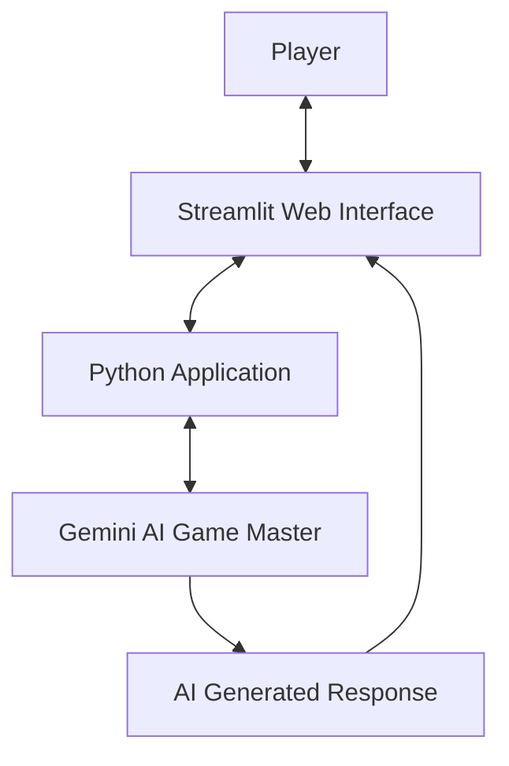
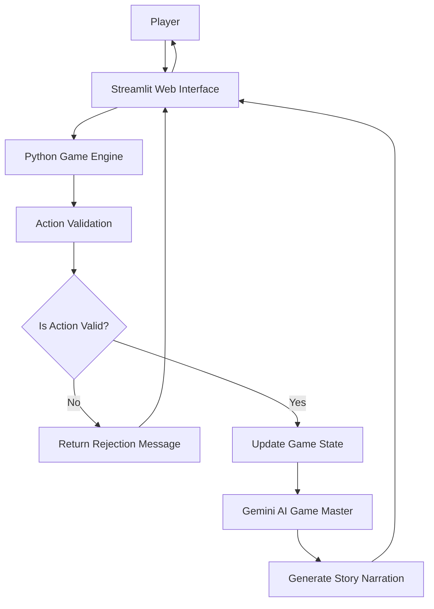

# AI Escape Room – Architecture Diagrams

## 1. Version 1 – Basic AI Escape Room

Version 1 uses a Streamlit interface to communicate with the player. The player's actions are sent to the Python application, which uses Gemini as the AI Game Master to generate responses and guide the player through the escape room.

### Explanation

- The player interacts with the game through the Streamlit interface.
- The Python application processes the player's input.
- Gemini acts as the Game Master and generates responses.
- The response is displayed to the player.
- The player continues interacting until they solve the escape room.

## 2. Version 2 – Structured AI Escape Room

Version 2 improves the first version by introducing a Python Game Engine that manages the game state and validates every player action. Gemini is used for storytelling, while Python controls the actual game rules.

### Explanation

- The player enters an action through Streamlit.
- The Python Game Engine checks whether the action is allowed.
- Invalid actions are rejected by Python.
- Valid actions update the inventory, clues, drawer and door status.
- Gemini generates storytelling based on the validated result.
- The updated response is displayed to the player.

### Main Improvement

Version 1 depends more heavily on AI-generated responses. Version 2 separates game logic from AI storytelling. Python controls the rules and game progress, making the second version more reliable and secure.

